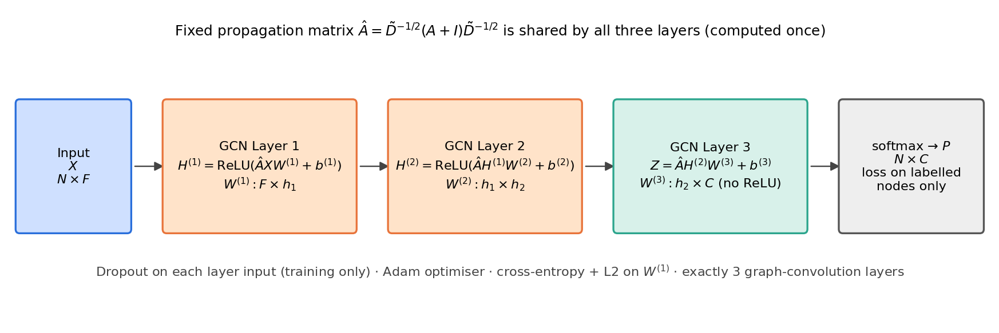
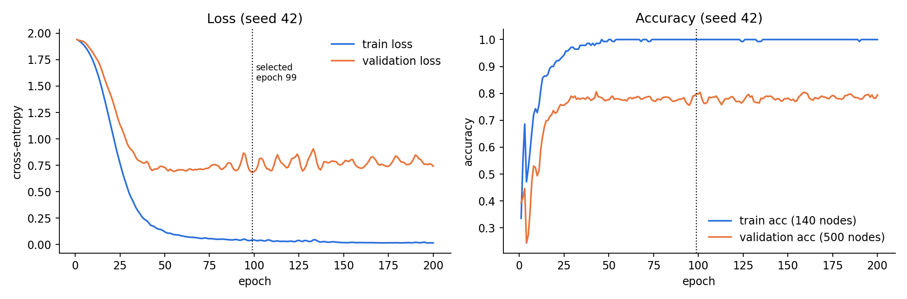
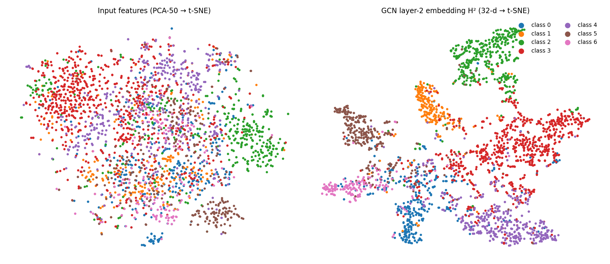

# Three-Layer Vanilla Graph Convolutional Network (GCN)

Derivation and from-scratch implementation of a GCN with **exactly three graph-convolution layers**, evaluated on the
**Cora** citation network (semi-supervised node classification).

* Assignment document (two-layer + three-layer, 27 pages): [`docs/GCN_Two_and_Three_Layer_Assignment.pdf`](docs/GCN_Two_and_Three_Layer_Assignment.pdf)
* Three-layer report (Phases 1–3, 16 pages): [`docs/GCN_Assignment_Report.pdf`](docs/GCN_Assignment_Report.pdf)
* Two-layer chapter with all codes and outputs (25 pages): [`docs/Two_Layer_GCN_and_Codes.pdf`](docs/Two_Layer_GCN_and_Codes.pdf)
* Every number below is copied from files in `outputs/`, produced by running the code.

## 1. Objective
Understand and derive the GCN propagation rule, implement each mathematical step explicitly, verify the hand-derived gradients, and train/evaluate
a three-layer GCN under a reproducible protocol — keeping the **fixed-weight numerical demonstration** clearly separate from the **trainable** model.

## 2. Mathematical background
| Quantity | Formula |
|---|---|
| Self-loops | `Ã = A + I` |
| Degrees | `D̃ᵢᵢ = Σⱼ Ãᵢⱼ` |
| Symmetric normalisation | `Â = D̃^(-1/2) Ã D̃^(-1/2)` |
| Layer 1 | `H¹ = ReLU(Â X W¹ + b¹)` |
| Layer 2 | `H² = ReLU(Â H¹ W² + b²)` |
| Layer 3 | `Z = Â H² W³ + b³`, `P = softmax(Z)` |
| Loss | `L = −(1/|V_L|) Σ_{i∈V_L} log P[i,yᵢ] + (λ/2)‖W¹‖²` |
| Gradients | `δ³ = M⊙(P−Y)/|V_L|`, `∂L/∂Wˡ = (ÂHˡ⁻¹)ᵀδˡ`, `δˡ⁻¹ = (Â δˡ Wˡᵀ)⊙mask⊙1[Zˡ⁻¹>0]` |

Derivation (spectral filter → Chebyshev K=1 → renormalisation trick), pseudocode and a numerical worked example are in the PDF (Section 6).

## 3. Data
**Cora** (Planetoid format, `data/cora/`, from github.com/kimiyoung/planetoid): 2,708 papers, 5,278 unique undirected citations,
1,433 word features (row-normalised), 7 classes, public split **140 train / 500 validation / 1,000 test**. Edge homophily 0.810.
A 4-node toy graph is used for the fixed-weight demo, and a 60-node synthetic block-model graph for the gradient check.

## 4. Code
| File | Content |
|---|---|
| `src/cora_data.py` | Cora loader (Planetoid files → sparse A, features, labels, masks) |
| `src/graph_data.py` | toy graph; synthetic 3-community graph |
| `src/gcn_ops.py` | one function per formula: self-loops, degrees, `Â` (dense and sparse), ReLU, softmax, layer, loss |
| `src/gcn_two_layer.py` | **two-layer GCN in NumPy**: same building blocks, hand-derived back-propagation, Adam, checkpoint rules |
| `src/run_two_layer_example.py` | two-layer examples: fixed-weight forward pass and a trained run on Zachary's Karate Club (2 labelled nodes) |
| `tests/gradient_check_two_layer.py` | finite-difference test for the two-layer back-propagation |
| `src/gcn_numpy.py` | **trainable three-layer GCN in NumPy**: manual back-propagation, Adam from scratch, Xavier init, dropout, L2, checkpoint selection, macro metrics |
| `src/demo_fixed_weights.py` | **fixed-weight demo, no training**: prints every intermediate matrix |
| `src/run_cora.py` | main experiment: 10 seeds, GCN vs. no-graph baseline |
| `tests/gradient_check.py` | finite-difference test of back-propagation |
| `src/gcn_torch.py`, `tests/test_torch_matches_numpy.py` | PyTorch version + equivalence test (**not executed — see note**) |
| `src/make_figures.py`, `src/make_cora_figures.py`, `src/make_two_layer_figures.py` | figures |
| `src/build_report.py`, `src/build_two_layer_doc.py`, `src/build_assignment_doc.py` | the three PDF documents |
| `src/run_training.py` | supplementary run on the small synthetic graph |

> **PyTorch note.** The environment used to prepare this package could not install PyTorch (no disk space), so `gcn_torch.py` and
> `tests/test_torch_matches_numpy.py` were written but **never run**. No result here comes from them. Please run the test locally first.

## 5. Run
```bash
pip install -r requirements.txt
bash run_all.sh            # demo, gradient check, Cora experiment (~12 min on 1 CPU core), figures, PDF
python src/run_cora.py     # only the main experiment
python src/run_two_layer_example.py   # two-layer examples (Karate Club)
```
Seeds: 42, 123, 456, 7, 8, 9, 10, 11, 12, 13. Settings: widths 1433→64→32→7, dropout 0.5, Adam lr 0.01, weight decay 5e-4 (layer 1),
200 epochs, checkpoint = lowest validation cross-entropy. Hyper-parameters were not tuned systematically.

## 6. Results (from `outputs/cora_output.txt`; 1,000 test nodes; mean ± sample std over 10 seeds)
| Metric | No graph (Â = I) | **3-layer GCN** |
|---|---|---|
| Accuracy | 0.5459 ± 0.0197 | **0.8160 ± 0.0082** |
| Macro precision | 0.5264 ± 0.0202 | **0.7991 ± 0.0071** |
| Macro recall | 0.5538 ± 0.0140 | **0.8129 ± 0.0109** |
| Macro F1 | 0.5303 ± 0.0193 | **0.8039 ± 0.0077** |
| Test loss | 1.3453 ± 0.0479 | **0.6032 ± 0.0180** |

Gradient checks (finite differences): three-layer worst relative error 2.3e-08, two-layer 2.4e-09 → both PASSED.

**Two-layer example (Karate Club, 2 labelled nodes, seed 42, final epoch):** accuracy on the 32 unlabelled nodes 0.8125; over seeds 0–9 mean 0.9406 ± 0.0453 (see `outputs/two_layer_example_output.txt`). This is a tiny graph and is not comparable with the Cora numbers. Per-seed results, confusion matrices and learning curves are in the PDF.





### Limitations
* One dataset and one fixed split; seeds vary only initialisation and dropout. Std values are not confidence intervals for other splits or datasets.
* Cora is strongly homophilous, which favours neighbourhood averaging.
* No systematic hyper-parameter search; no comparison with other architectures or other depths (depth is fixed at three by the assignment).
* The t-SNE figure is illustrative only; no cluster-quality metric was computed.
* PyTorch implementation not executed by the package author.

## 7. References
Kipf & Welling, *Semi-Supervised Classification with Graph Convolutional Networks*, ICLR 2017 · Yang, Cohen & Salakhutdinov, *Revisiting Semi-Supervised Learning with Graph Embeddings*, ICML 2016.
